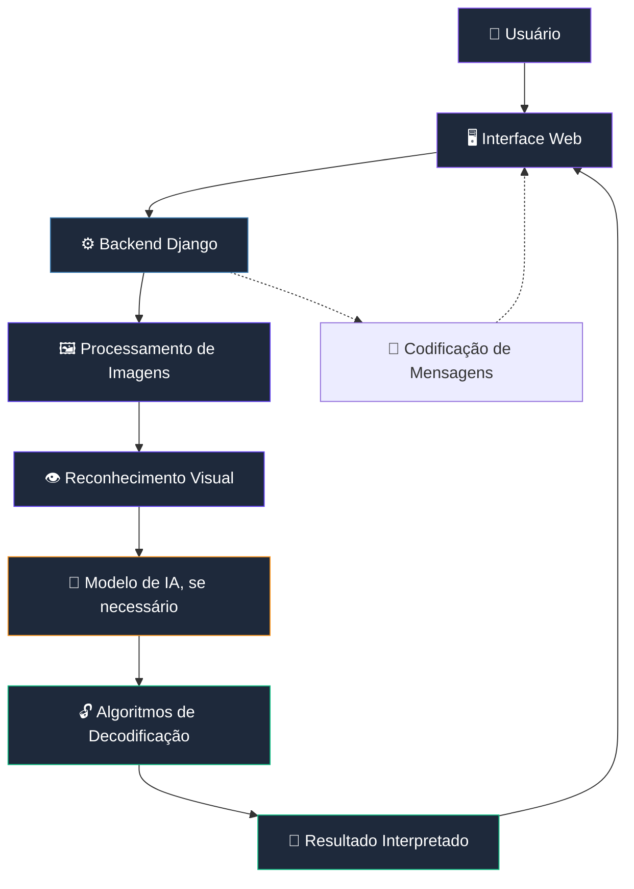

<div align="center">

# ◈ CodeVision

### SEE THE CODE BEHIND THE IMAGE.

**Uma nova perspectiva para codificar, decodificar e interpretar mensagens por meio da visão computacional.**

Transformando imagens em informação com Python, inteligência artificial e processamento digital de imagens.

<br>


<br>

[Visão geral](#-visão-geral) •
[Funcionalidades](#-funcionalidades) •
[Tecnologias](#-tecnologias) •
[Arquitetura](#-arquitetura) •
[Instalação](#-instalação) •
[Roadmap](#-roadmap)

</div>

---

## ◈ Visão geral

O **CodeVision** é um projeto acadêmico que explora a aplicação da **inteligência artificial e da visão computacional no reconhecimento e na interpretação de mensagens codificadas presentes em imagens**.

A proposta é desenvolver uma aplicação capaz de receber imagens, analisar seus elementos visuais, identificar padrões associados a sistemas de codificação e converter as informações reconhecidas em mensagens compreensíveis.

Além da decodificação, o projeto pretende explorar o caminho inverso: transformar mensagens de texto em representações visuais codificadas.

O objetivo é combinar processamento de imagens, algoritmos de codificação e uma interface intuitiva em uma única aplicação.

> **Da imagem à informação. Do código à compreensão.**

## 🎯 Objetivos do projeto

- Desenvolver uma aplicação que utilize visão computacional para interpretar informações presentes em imagens.
- Explorar técnicas de inteligência artificial aplicadas ao reconhecimento de padrões visuais.
- Implementar algoritmos de codificação e decodificação de mensagens.
- Criar uma interface moderna, intuitiva e acessível.
- Integrar o processamento de imagens a uma aplicação web.
- Aplicar, na prática, conhecimentos de programação, algoritmos e desenvolvimento de software.

## ✨ Funcionalidades

As funcionalidades abaixo representam o escopo planejado para o projeto. Elas serão implementadas e validadas durante o desenvolvimento.

### 🖼️ Análise de imagens

Recebimento de imagens enviadas pelo usuário e preparação dos arquivos para análise computacional.

### 👁️ Reconhecimento visual

Utilização de técnicas de visão computacional e, conforme a abordagem definida, modelos de inteligência artificial para reconhecer símbolos, padrões e elementos relevantes.

### 🔓 Decodificação de mensagens

Interpretação dos elementos reconhecidos e conversão de sequências codificadas em texto legível, de acordo com os sistemas de codificação suportados.

### 🔐 Codificação de mensagens

Conversão de textos em representações codificadas, com possibilidade de gerar imagens que possam ser posteriormente analisadas pela aplicação.

### 📚 Tabelas de conversão

Apresentação de referências que relacionem os símbolos reconhecidos aos seus respectivos significados.

### 💻 Interface web

Desenvolvimento de uma interface visual moderna para envio de imagens, acompanhamento do processamento e exibição dos resultados.

---

## 🛠️ Tecnologias

O projeto pretende utilizar as seguintes tecnologias. A seleção definitiva das bibliotecas de inteligência artificial dependerá dos requisitos acadêmicos e dos experimentos realizados durante o desenvolvimento.

<div align="center">

### Linguagem e backend


<br>


### Visão computacional e inteligência artificial


### Frontend


### Desenvolvimento e versionamento


</div>

### Papel de cada tecnologia

| Tecnologia | Aplicação no projeto |
|---|---|
| **Python** | Linguagem principal para implementar os algoritmos e integrar os componentes. |
| **Django** | Desenvolvimento do backend e das funcionalidades da aplicação web. |
| **OpenCV** | Leitura, preparação e processamento das imagens. |
| **Scikit-learn** | Experimentação com modelos de aprendizado de máquina, caso sejam adequados à tarefa. |
| **HTML5** | Estrutura das páginas. |
| **CSS3** | Identidade visual, responsividade e componentes da interface. |
| **JavaScript** | Interatividade e comunicação com o backend. |
| **Git e GitHub** | Controle de versão, histórico de alterações e colaboração. |

> **Nota técnica:** OpenCV e Scikit-learn são opções previstas, não uma definição de que todo o processamento dependerá de IA. Algoritmos determinísticos podem ser mais adequados para algumas etapas, como converter símbolos reconhecidos em caracteres.

---

## 🏗️ Arquitetura

A aplicação será organizada em componentes com responsabilidades distintas, facilitando a manutenção, a evolução e os testes.



*Diagrama conceitual da arquitetura pretendida. A implementação poderá ser ajustada conforme os resultados dos testes.*

### Fluxo de processamento

1. O usuário envia uma imagem pela interface.
2. O backend recebe e valida o arquivo.
3. O processamento de imagens prepara os dados para análise.
4. O componente de reconhecimento identifica os elementos relevantes.
5. O sistema interpreta os elementos utilizando as regras ou os modelos correspondentes.
6. O resultado é apresentado ao usuário.

A arquitetura busca manter o reconhecimento visual separado das regras de codificação e decodificação, permitindo testar cada componente de maneira independente.

---

## 📂 Estrutura do projeto

A organização inicial do repositório está planejada da seguinte forma:

```text
CodeVision/
├── backend/       # Backend e aplicação web
├── codigos/       # Algoritmos de codificação e decodificação
├── datasets/      # Conjuntos de dados para experimentos
├── docs/          # Documentação e materiais acadêmicos
├── frontend/      # Interface da aplicação
├── ia/            # Experimentos e componentes de inteligência artificial
├── testes/        # Testes e validações
├── .gitignore
└── README.md
```

Essa estrutura representa a organização inicial. Os diretórios poderão receber subpastas e arquivos à medida que os componentes forem implementados.

---

## 🚀 Instalação

### Pré-requisitos

Antes de iniciar, verifique se o ambiente possui:

- Python 3 instalado.
- Git instalado.
- Visual Studio Code ou outro editor de sua preferência.

### 1. Clone o repositório

```bash
git clone https://github.com/Matheus-Nunes223/CodeVision.git
```

### 2. Entre na pasta do projeto

```bash
cd CodeVision
```

### 3. Crie um ambiente virtual

No Linux:

```bash
python3 -m venv .venv
```

Ative o ambiente:

```bash
source .venv/bin/activate
```

### 4. Instale as dependências

A lista definitiva de dependências será adicionada ao projeto quando o ambiente e os primeiros componentes estiverem configurados.

Quando o arquivo `requirements.txt` estiver disponível, utilize:

```bash
pip install -r requirements.txt
```

### 5. Execute a aplicação

As instruções específicas de execução serão adicionadas assim que o backend e a interface estiverem implementados.

---

## 🗺️ Roadmap

O desenvolvimento será dividido em etapas para manter o escopo viável e permitir a validação progressiva das funcionalidades.

- [x] Criar o repositório no GitHub.
- [x] Definir a estrutura inicial de diretórios.
- [x] Configurar o controle de versão.
- [ ] Definir o primeiro sistema de codificação suportado.
- [ ] Implementar os algoritmos básicos de codificação e decodificação.
- [ ] Criar o fluxo de recebimento e validação de imagens.
- [ ] Implementar o processamento visual.
- [ ] Avaliar e integrar uma abordagem de reconhecimento visual.
- [ ] Desenvolver a interface web.
- [ ] Integrar frontend e backend.
- [ ] Criar testes para os componentes.
- [ ] Validar a aplicação com diferentes imagens e condições.
- [ ] Documentar a instalação e o uso da versão funcional.

*As etapas serão atualizadas conforme o desenvolvimento avançar.*

---

## 🧪 Testes e validação

A validação deverá considerar diferentes condições de entrada, como:

- Imagens com diferentes dimensões.
- Variações de iluminação e contraste.
- Diferentes posicionamentos dos símbolos.
- Imagens com ruído ou baixa qualidade.
- Entradas inválidas ou que não contenham mensagens reconhecíveis.
- Casos em que a interpretação seja ambígua.

Os testes ajudarão a avaliar a confiabilidade do processamento e a identificar as limitações da solução.

---

## 🎓 Contexto acadêmico

O CodeVision é um projeto acadêmico voltado à aplicação prática de conceitos de programação, visão computacional, inteligência artificial e desenvolvimento web.

O desenvolvimento busca unir fundamentos teóricos e implementação prática, priorizando uma arquitetura organizada, experimentação e evolução incremental.

---

## 👨‍💻 Autor

**Matheus Nunes**

Estudante de Engenharia de Software, interessado em desenvolvimento de software, inteligência artificial e visão computacional.

[](https://github.com/Matheus-Nunes223)

---

<div align="center">

### ◈ CodeVision

**SEE THE CODE BEHIND THE IMAGE.**

*Transformando padrões visuais em informação.*

<br>


</div>